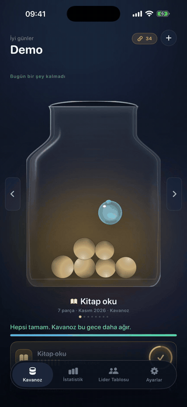

# Alışkanlıklar

A habit tracker with a jar instead of a streak. When you finish a habit, a real object drops into the jar, bounces and settles. Once it settles, it never moves again.

Every habit has its own jar. One big pile would only be a total, and a total is just a number. Jars are monthly: when the month turns, the full jar goes to the archive exactly as it landed and an empty one starts. You pick the container, its colour and what falls into it.

Not out yet. The code is private.

SwiftUI, SpriteKit, SwiftData, iOS 18+.
